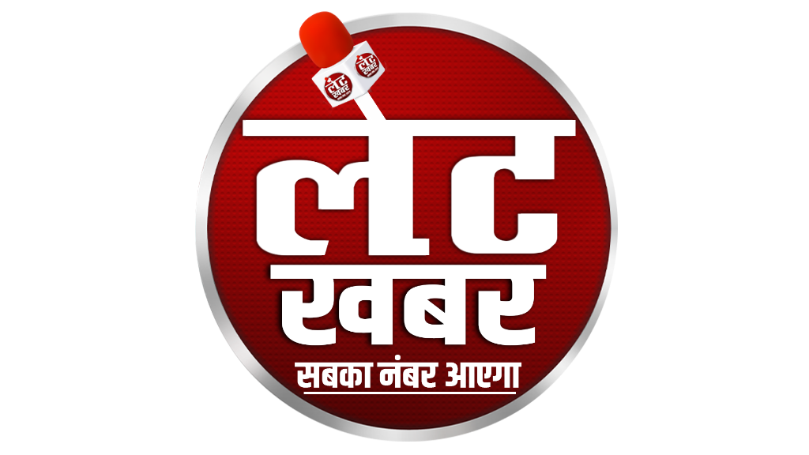

<p align="center">
  
</p>

<h1 align="center">Late Khabar</h1>

<p align="center">
  <strong>Modern Editorialism & Independent Journalism Web Application</strong>
</p>

<p align="center">
  
  
  
  
  
</p>

---

## 📌 Overview

**Late Khabar** is a high-performance, bilingual (Hindi & English) editorial news platform delivering breaking alerts, trending national and global stories, and state/city regional journalism with user personalization, bookmarking, and a dedicated editorial management portal.

---

## ✨ Features

- **🌐 Bilingual Content Support**: Seamless English and Hindi (`EN` / `हिन्दी`) toggling across all public screens, category pages, and news details.
- **⚡ Real-time News Feeds**: Breaking news ticker, featured hero stories, trending widgets, and multimedia video reports.
- **📍 Regional & Local News Explorer**: Location-filtered news feed with state and city level navigation.
- **🔍 Full-Text Search & Filtering**: Keyword search across bilingual titles and contents with category filters.
- **🔖 Bookmark & Offline Reading**: Save stories to personal collection backed by Supabase `public.bookmarks`.
- **🔐 Secure Authentication**: Google OAuth and email sign-in/sign-up powered by Supabase Auth and PostgreSQL Row Level Security (RLS).
- **🛡️ Editorial Admin Dashboard**:
  - Full news article CRUD (Create, Read, Update, Delete) with image and video support.
  - Category management (English & Hindi naming and slugs).
  - User and role management with secure Edge Function integration.
  - Media uploads backed by Supabase Storage buckets.
  - Platform analytics and readership engagement overview.
- **🌓 Dark & Light Modes**: Class-based theme engine with persistent user preference storage.

---

## 🛠️ Technology Stack

- **Frontend**: React 19, TypeScript
- **Build Tool**: Vite
- **Styling**: Tailwind CSS (v4) with Vanilla CSS design tokens
- **Routing**: React Router (`react-router-dom` v7)
- **Backend & Database**: Supabase PostgreSQL
- **Authentication**: Supabase Auth (Google OAuth & Email/Password)
- **Storage**: Supabase Storage (`news-images`, `user-avatars`)
- **Icons**: Lucide React
- **Linter**: Oxlint

---

## 🚀 Getting Started

### Prerequisites

- Node.js (v18 or higher recommended)
- npm or pnpm or yarn
- Supabase project credentials

### Installation

1. **Clone the repository**:
   ```bash
   git clone https://github.com/amanpandey8120/Latekhabar.git
   cd Latekhabar
   ```

2. **Install dependencies**:
   ```bash
   npm install
   ```

3. **Configure Environment Variables**:
   Create a `.env` file in the root directory:
   ```env
   VITE_SUPABASE_URL=https://your-project.supabase.co
   VITE_SUPABASE_ANON_KEY=your-supabase-anon-key
   ```

4. **Start the development server**:
   ```bash
   npm run dev
   ```

5. **Build for production**:
   ```bash
   npm run build
   ```

---

## 📂 Project Structure

```
Latekhabar/
├── public/
│   ├── logo.png               # Late Khabar brand logo
│   └── favicon.ico
├── src/
│   ├── components/            # Reusable UI components (common, news, admin)
│   ├── constants/             # Static configurations & regional location datasets
│   ├── context/               # React Contexts (AuthContext, LanguageContext, ThemeContext)
│   ├── layouts/               # Layout shells (PublicLayout, AdminLayout)
│   ├── lib/                   # Supabase client & environment helpers
│   ├── pages/
│   │   ├── admin/             # Admin Dashboard, Article CRUD, User & Category Management
│   │   └── public/            # Home, Category, Article Details, Search, Saved, Auth
│   ├── services/              # Supabase database & storage services (newsService, bookmarkService, adminService)
│   └── types/                 # TypeScript interfaces and Supabase table schema types
├── supabase/
│   ├── functions/             # Supabase Edge Functions (create-user, delete-user)
│   └── schema.sql             # Canonical PostgreSQL schema & RLS policies
└── package.json
```

---

## 📬 Contact & Official Channels

For editorial inquiries, news tips, support, or partnerships, connect with the Late Khabar team:

- **📧 Email**: [latekhabarrewa@gmail.com](mailto:latekhabarrewa@gmail.com)
- **📸 Instagram**: [@latekhabar](https://www.instagram.com/latekhabar?utm_source=ig_web_button_share_sheet&stkn=ZDNlZDc0MzIxNw==)
- **👥 Facebook**: [Late Khabar Rewa](https://www.facebook.com/latekhabarrewa)

---

## 📄 License

This project is proprietary software for Late Khabar Media Inc. All rights reserved.
